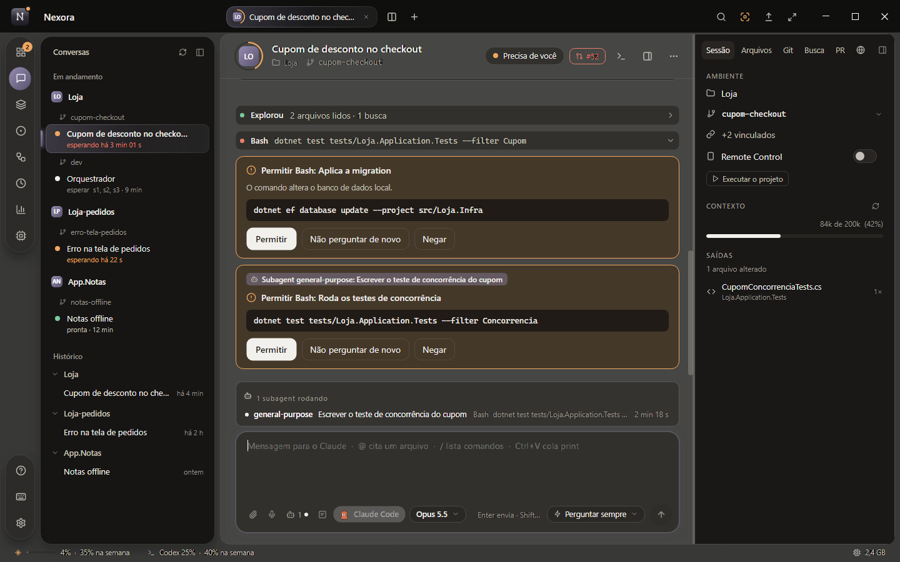
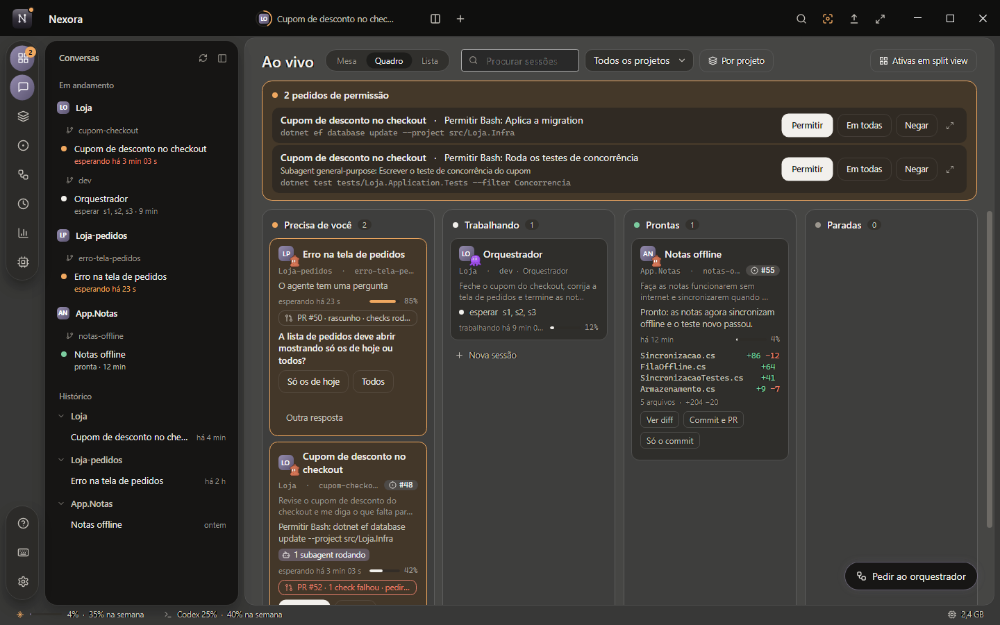
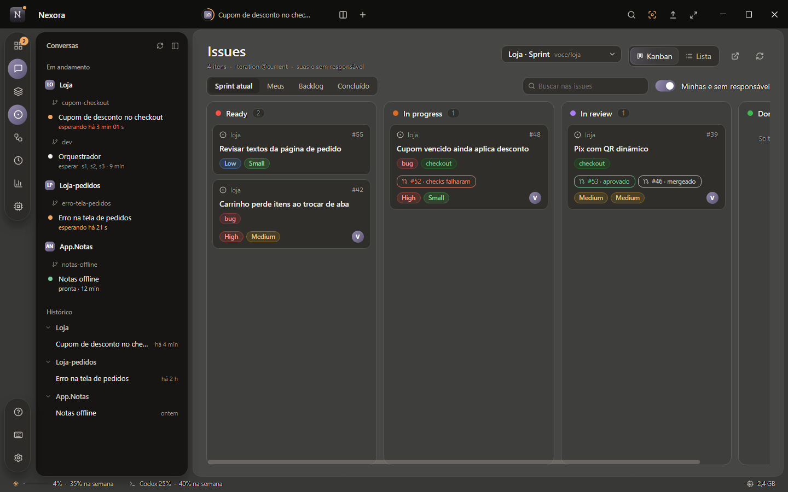

# Nexora

[Português](README.pt-BR.md) · [Website](https://nexora.suiciniv.dev) · [Releases](https://github.com/suiciniv-dev/nexora-releases/releases) · [Contributing](CONTRIBUTING.md)

A desktop app to run, watch and orchestrate your coding agents in one place.

Nexora wraps the agent CLIs you already use (Claude Code, Codex, Gemini CLI and more) in a single window: many conversations side by side, a live board of everything that is running, permission requests answered from one spot, files and diffs next to the chat, and the option to run an agent on a cloud machine so it keeps working with your PC off.



## Why Nexora

- **One window for all your agents.** Chats, history inherited from the CLI, worktrees per task, an editor with diff, and a terminal.
- **Live board.** See which sessions are working, waiting for you, ready or stopped. Answer permission requests and questions without opening each tab.
- **Orchestrator.** Ask for a goal and let it split the work across sessions and subagents, with a per-subagent model and a queue when you hit a limit.
- **Review and PR flow.** Comment diff lines and send the comments to the agent. Issues board, PR panel, commit and PR from the app.
- **Cloud machines.** Run the agent on your own server over SSH, or on InstaBox or Freestyle. Pause the machine when you are done.
- **A `nexora` command** for the terminal and for scripts or other agents (`--json` output, exit codes that say when something needs you).
- **Your credentials stay with the agent.** Each session is a process of the official CLI using its own login. Secrets an agent asks for go through a protected form, not the chat, and are stored with Windows DPAPI or the macOS Keychain.





## Supported agents

Claude Code and Codex have the deepest support. These also work: Gemini CLI, Antigravity, GitHub Copilot, Cursor, OpenCode, Kiro, Qwen Code, Grok, goose, and any agent that speaks ACP over stdio.

Nexora only finds an agent whose command is on your `PATH`. Install and log in to each agent the way its own documentation says. [docs/testar-agentes.md](docs/testar-agentes.md) (Portuguese) has a checklist to test a new one.

## Install

Download the latest build from the [releases page](https://github.com/suiciniv-dev/nexora-releases/releases) or from [nexora.suiciniv.dev](https://nexora.suiciniv.dev).

| Platform | File | Notes |
|---|---|---|
| Windows 10 / 11 (x64) | `Nexora-Setup-<version>.exe` | Installs for your user only, no administrator needed |
| Windows, restricted PCs | `Nexora-Portatil-<version>.zip` | Extract and run `instalar.cmd`. Needs the .NET 10 runtime |
| macOS | `.dmg` | Currently one version behind (0.7.1) |

Builds are not code-signed. On Windows, click **More info** then **Run anyway**. Linux is not supported yet.

## Requirements

- At least one supported agent CLI installed and logged in (for Claude Code, `claude` on your `PATH` or in `~/.local/bin`).
- Windows 10 or 11 (x64), or macOS.
- To build from source: the [.NET 10 SDK](https://dotnet.microsoft.com/download).

## Run from source

```powershell
git clone https://github.com/suiciniv-dev/nexora.git
cd nexora
dotnet run --project src/Nexora
```

Try it without any agent installed, with sample data:

```powershell
dotnet run --project src/Nexora -- --demo --isolada
```

Run the tests (headless):

```powershell
dotnet test tests/Nexora.Testes
```

More options (screenshots, opening a page directly, isolated sessions) are listed in [docs/desenvolvimento.md](docs/desenvolvimento.md) (Portuguese).

## Roadmap

Planned or in progress:

- `nexora` command v2: approve and deny from the terminal, follow a session, `nexora://` links, MCP, English help.
- Automatic permission mode.
- Codex and ACP agents on cloud machines.
- Chat and terminal of the same agent side by side.
- Configurable keyboard shortcuts.
- Fresh macOS builds (the Mac installer is one version behind).

Freestyle support was written from its documentation and has not been tested against a real account yet.

## Contributing

Issues and pull requests are welcome. Please read [CONTRIBUTING.md](CONTRIBUTING.md) first. To report a vulnerability, see [SECURITY.md](SECURITY.md).

## License

[MIT](LICENSE). Third-party notices are in [THIRD-PARTY-NOTICES.md](THIRD-PARTY-NOTICES.md).
