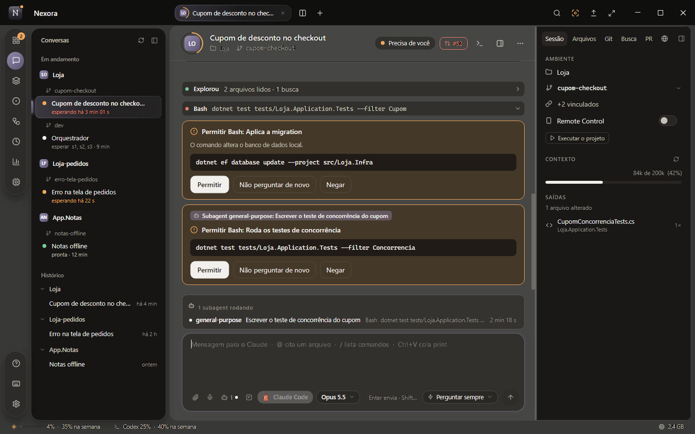
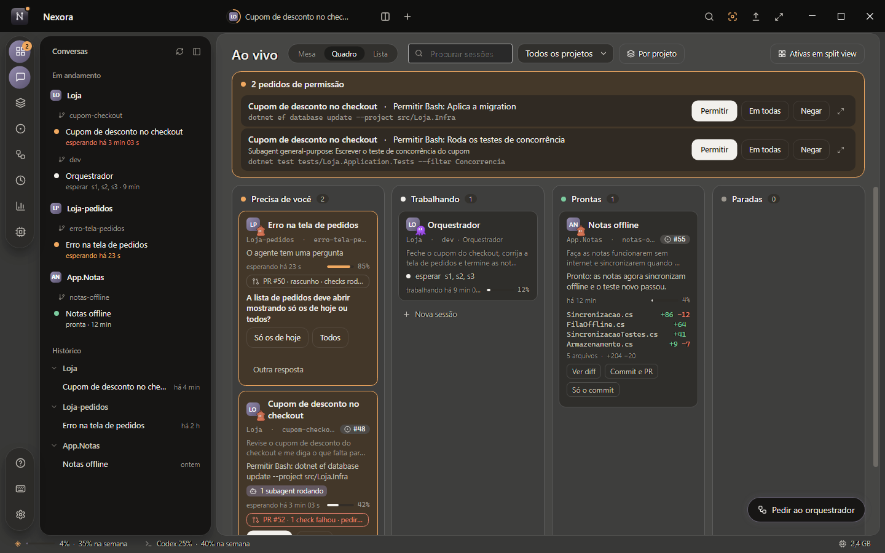
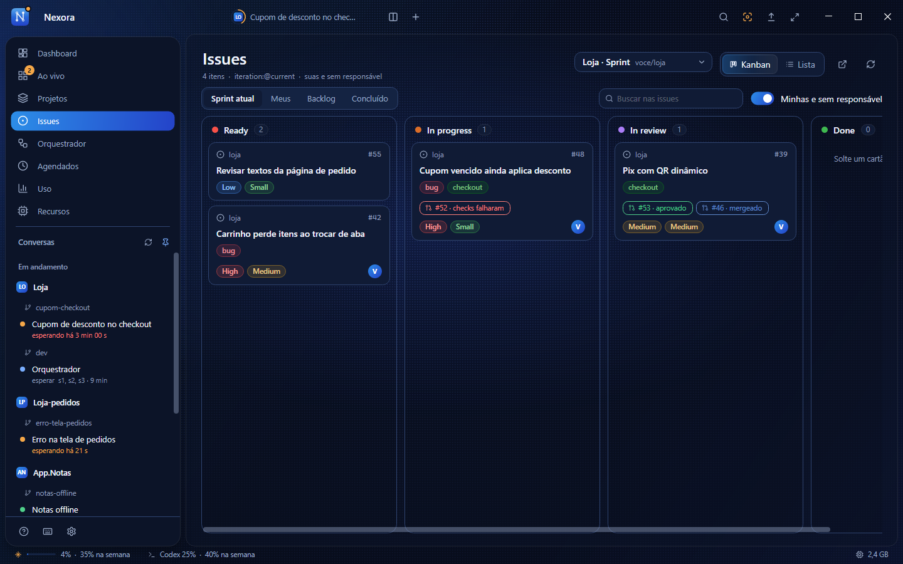

# Nexora

[English](README.md) · [Site](https://nexora.suiciniv.dev) · [Releases](https://github.com/suiciniv-dev/nexora-releases/releases) · [Como contribuir](CONTRIBUTING.md)

Um app de desktop para rodar, acompanhar e orquestrar seus agentes de programação num só lugar.

O Nexora envolve os agentes de linha de comando que você já usa (Claude Code, Codex, Gemini CLI e outros) numa única janela: várias conversas lado a lado, um quadro ao vivo de tudo o que está rodando, pedidos de permissão respondidos de um lugar só, arquivos e diffs ao lado do chat, e a opção de rodar o agente numa máquina na nuvem para ele continuar trabalhando com o seu PC desligado.



## Por que o Nexora

- **Uma janela para todos os agentes.** Conversas, histórico herdado do CLI, worktrees por tarefa, editor com diff e terminal.
- **Quadro ao vivo.** Veja quais sessões estão trabalhando, esperando por você, prontas ou paradas. Responda permissões e perguntas sem abrir aba por aba.
- **Orquestrador.** Peça um objetivo e deixe ele dividir o trabalho entre sessões e subagents, com modelo por subagent e fila quando você bate num limite.
- **Revisão e PR.** Comente linhas do diff e mande os comentários para o agente. Quadro de issues, painel de PR, commit e PR direto do app.
- **Máquinas na nuvem.** Rode o agente no seu servidor por SSH, ou no InstaBox ou na Freestyle. Pause a máquina quando terminar.
- **Um comando `nexora`** para o terminal e para scripts ou outros agentes (saída `--json` e códigos de saída que avisam quando algo precisa de você).
- **Suas credenciais ficam com o agente.** Cada sessão é um processo do CLI oficial, com o login dele. Segredos que um agente pede passam por um formulário protegido, não pelo chat, e ficam guardados no DPAPI do Windows ou no Keychain do macOS.





## Agentes compatíveis

Claude Code e Codex têm o suporte mais completo. Também funcionam: Gemini CLI, Antigravity, GitHub Copilot, Cursor, OpenCode, Kiro, Qwen Code, Grok, goose e qualquer agente que fale ACP por stdio.

O Nexora só acha o agente cujo comando está no `PATH`. Instale e faça o login de cada um como a documentação dele manda. [docs/testar-agentes.md](docs/testar-agentes.md) traz um roteiro para testar um agente novo.

## Instalação

Baixe a versão mais recente na [página de releases](https://github.com/suiciniv-dev/nexora-releases/releases) ou em [nexora.suiciniv.dev](https://nexora.suiciniv.dev).

| Plataforma | Arquivo | Observações |
|---|---|---|
| Windows 10 / 11 (x64) | `Nexora-Setup-<versão>.exe` | Instala só no seu usuário, sem pedir administrador |
| Windows, PCs restritos | `Nexora-Portatil-<versão>.zip` | Extraia e rode o `instalar.cmd`. Precisa do runtime do .NET 10 |
| macOS | `.dmg` | Hoje uma versão atrás (0.7.1) |

Os arquivos não têm assinatura. No Windows, clique em **Mais informações** e depois em **Executar assim mesmo**. Linux ainda não é suportado.

## Requisitos

- Pelo menos um agente suportado instalado e logado (no Claude Code, o `claude` no `PATH` ou em `~/.local/bin`).
- Windows 10 ou 11 (x64), ou macOS.
- Para compilar do código: o [SDK do .NET 10](https://dotnet.microsoft.com/download).

## Rodar pelo código

```powershell
git clone https://github.com/suiciniv-dev/nexora.git
cd nexora
dotnet run --project src/Nexora
```

Para ver sem nenhum agente instalado, com dados de exemplo:

```powershell
dotnet run --project src/Nexora -- --demo --isolada
```

Rodar os testes (headless):

```powershell
dotnet test tests/Nexora.Testes
```

Mais opções (capturas de tela, abrir uma página direto, sessões isoladas) estão em [docs/desenvolvimento.md](docs/desenvolvimento.md).

Como o app é construído (sessões, protocolos, orquestrador, máquinas na nuvem, segredos): [docs/architecture.md](docs/architecture.md), em inglês.

## Roadmap

Planejado ou em andamento:

- Comando `nexora` v2: aprovar e negar pelo terminal, seguir uma sessão, links `nexora://`, MCP, ajuda em inglês.
- Modo de permissão Automático.
- Codex e agentes ACP nas máquinas na nuvem.
- Chat e terminal do mesmo agente lado a lado.
- Atalhos de teclado configuráveis.
- Instaladores novos para macOS (o do Mac está uma versão atrás).

O suporte à Freestyle foi escrito pela documentação dela e ainda não foi testado com uma conta de verdade.

## Contribuindo

Issues e pull requests são bem-vindos. Leia antes o [CONTRIBUTING.md](CONTRIBUTING.md). Para relatar uma vulnerabilidade, veja o [SECURITY.md](SECURITY.md).

## Licença

[MIT](LICENSE). Os avisos de terceiros estão em [THIRD-PARTY-NOTICES.md](THIRD-PARTY-NOTICES.md).
